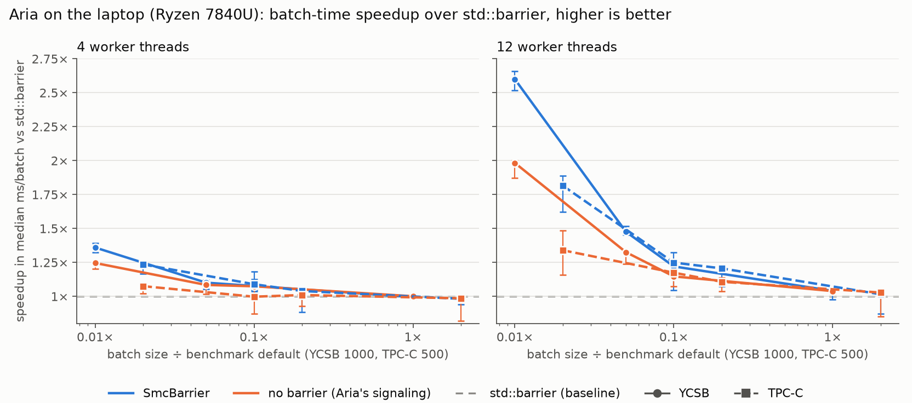

**Yi Lu**, Xiangyao Yu, Lei Cao, Samuel Madden

[Aria: A Fast and Practical Deterministic OLTP Database]()

*Proc. of the VLDB Endowment (PVLDB), Volume 13, Tokyo, Japan, 2020.*

[](https://travis-ci.org/luyi0619/aria)

# Dependencies

```sh
sudo apt-get update
sudo apt-get install -y zip make cmake g++ libjemalloc-dev libboost-dev libgoogle-glog-dev
```

# Download

```sh
git clone https://github.com/luyi0619/aria.git
```

# Build

```
./compile.sh
```

# Additions in this fork

The phase barriers (`common/Barrier.h`) of the batch protocols can use `SmcBarrier` from
[smc_barrier](https://github.com/lxbtlr/smc_barrier) (`-DSMC_BARRIER=ON`) instead of
`std::barrier`. `--seed` and `--batches` (or `--commits`) make runs deterministic and log a database
checksum, so barrier builds can be checked for identical results and timed on identical work with the
scripts below.

**Preliminary result** (laptop, Ryzen 7 7840U, one NUMA node; 5 runs per point on identical work,
checksums identical across builds): `SmcBarrier` cuts batch time by up to 2.6× over `std::barrier`
at small batch sizes, where the barrier is a large share of each batch, and is on par at the default
sizes. Below the default batch size it also matches or beats Aria's original barrier-free signaling,
clearly so at 12 threads.



<details>
<summary>Scripts, flags and dependencies</summary>

**Clone with submodules**: smc_barrier lives in `external/smc_barrier`.

```sh
git clone --recursive https://github.com/andrewcrotty/aria.git
```

**CMake options**

- `-DUSE_BARRIER=ON` (off by default): phase barriers instead of the original signaling in every
  batch protocol (Aria, AriaFB, Bohm, Calvin and Pwv): each manager and its workers meet at the
  barrier at each phase boundary. Single node only (the managers check it). TwoPL has no batches and
  is unaffected.
- `-DSMC_BARRIER=ON`: use `SmcBarrier`, with slots grouped by the NUMA nodes of the CPUs the
  workers are pinned to. Needs `-DASMJIT_ROOT=<prefix>` (defaults to `$ASMJIT`).

**Run flags**

- `--seed=S` (Aria): seed worker i's generator with `S + i`, so every run executes the same
  transactions. AriaFB, Bohm, Calvin and Pwv always seed worker i with i.
- `--batches=N` (every batch protocol): stop after N batches instead of after a fixed time, then log
  the elapsed time, ms per batch, commit/abort totals and a checksum of every table. With the same
  seed, batches and threads, every correct build must log the same checksum. Each table's share is
  logged too (`table checksum:`, and `load table checksum:` right after loading), to trace a
  mismatch to a table. Values serialized as a raw struct copy are hashed field by field, so struct
  padding does not count; Bohm's multi-version tables are hashed over each key's newest version.
- `--commits=N` (Aria): like `--batches`, but stop after the batch in which N transactions have
  committed.
- `--retry_aborts` (Aria): retry conflict aborts at the front of the next batch (by default they are
  dropped, as in the original Aria). With `--commits` the work is then N commits, not N attempts.
- `--time_to_run=S --warmup=W --cooldown=C` (every protocol; default 25, 10 and 5 s as in the
  original): runs without `--batches` / `--commits` last S seconds and log the average commit/s over
  the seconds after W and before C.
- `--dump_table=ID --dump_file=PATH` (TPC-C): after the run, write table ID's rows (key hash and the
  hashed value bytes in hex) to PATH, to diff two runs row by row.

On a single node the I/O dispatchers exit at once, so they are no longer pinned: the workers (then the
manager) are pinned to consecutive CPUs from `--cpu_core_id`.

**Scripts** (run from the repo root; they build `build-det-{std,smc,nobar}`, i.e. `std::barrier`,
`SmcBarrier` and no barrier, and share `scripts/barrier_common.sh`. Environment: `BUILD_PREFIX`
replaces `build-det` (e.g. per host on a shared checkout), `RUN_TIMEOUT` kills a hung run (default
600 s), `ARIA_EXTRA` adds flags to every run, `PROTOCOL` runs another protocol (default Aria; see
below). `-R` in the scripts below is retry mode: `--retry_aborts`, and the work is a commit target,
`--commits`.)

- `scripts/check_barrier_determinism.sh [-t "1 2 4 8"] [-b BATCHES] [-R [-C COMMITS]] [-s SEED] [-o DIR]`:
  runs YCSB and TPC-C on each build at each thread count and fails unless every build logs the same
  checksum and totals, and a different seed changes the checksum.
- `scripts/compare_barrier_speed.sh [-t "4 12"] [-B "10 100 1000" | -F "0.01 0.1 1"] [-r REPS] [-y TXNS] [-c TXNS] [-R] [-s SEED] [-o DIR]`:
  times every build on identical work, `REPS` runs per point with the build order rotated, and prints
  median/min/max ms per batch and the speedup over `std::barrier`. `-B` sweeps the batch size, `-F`
  the same as fractions of each benchmark's default (YCSB 1000, TPC-C 500); `-y`/`-c` fix the
  transactions per run (attempts, or commits with `-R`), and ms/batch divides by the logged batch
  count. It also fails on any checksum mismatch. Every run is written to `DIR/results.csv`; rerunning
  with the same `DIR` skips the runs already there.
- `scripts/slurm_barrier_sweep.sbatch "<threads>" "<sizes>" [REPS]`: one `compare_barrier_speed.sh`
  sweep as an exclusive Slurm job (`sbatch -p <partition> -w <node> ...`; see the header for
  `SWEEP_FLAG=-F`, `OUTDIR` and `RETRY=1`).
- `scripts/skew_barrier_speed.sh [-P PROTOCOL] [-t "8 15"] [-B "10 100 1000"] [-z "0 ... 0.999"] [-k KEYS] [-r REPS] [-y TXNS | -T SECONDS] [-D] [-s SEED] [-o DIR]`:
  YCSB across skew factors, the workload of the paper's Fig. 11 (Zipfian keys over the whole table,
  `-k` keys per partition, default 40000), on every build. `-P` picks the protocol (Aria, AriaFB,
  Bohm, Calvin, Pwv or TwoPL), with the paper's per-protocol flags and `LOCK_MANAGERS` lock managers
  for Calvin and AriaFB (default 1). `-D` drops conflict aborts (the original Aria; the default is
  retry mode); protocols other than Aria need `-D`, and TwoPL, which has no batches, needs `-T`.
  `-T SECONDS` runs for a fixed time instead of a fixed amount of work (`WARMUP` and `COOLDOWN`
  seconds, default 3 and 1, are left out of the average) and skips the checksum check.
- `scripts/slurm_skew_sweep.sbatch "<threads>" "<sizes>" [REPS]`: one `skew_barrier_speed.sh` sweep
  as an exclusive Slurm job; `ZIPFS`, `TXNS`, `DROP=1`, `TIMED=S`, `PROTOCOL` and `LOCK_MANAGERS`
  in the environment (see the header).
- `scripts/plot_barrier_speedup.py RESULTS_CSV [--ms] [--absolute] [--cores N [--cpu-offset C]]`: one
  panel per thread count; speedup over `std::barrier` (or median ms/batch with `--ms`) against the
  batch size, normalized to each benchmark's default (raw with `--absolute`). `--cores` labels each
  panel with the cores used or the share running two hyperthreads.
- `scripts/repro_checksum.sh [-b ycsb|tpcc] [-t THREADS] [-B SIZE] [-w WORK] [-n RUNS] [-R] [-d TABLE] [-o DIR]`:
  runs one configuration `RUNS` times per build to catch a rare checksum mismatch, records every
  table's checksum per run, and names the tables an outlier differs in (at load and at the end);
  `-d` also keeps the outliers' row dumps of that table.

**New dependencies**

- gflags and glog are found through their CMake packages (`find_package`), which glog >= 0.7
  requires: install `libgflags-dev` along with `libgoogle-glog-dev`. Tested with glog 0.7 and gflags
  2.3 from nixpkgs; older Ubuntu packages are untested.
- `-DSMC_BARRIER=ON` needs a static AsmJit at revision `677a10b` (see smc_barrier's README).
- The scripts need bash 4+, `timeout` (coreutils) and `awk`; the plot script needs Python 3 with
  matplotlib.

</details>
